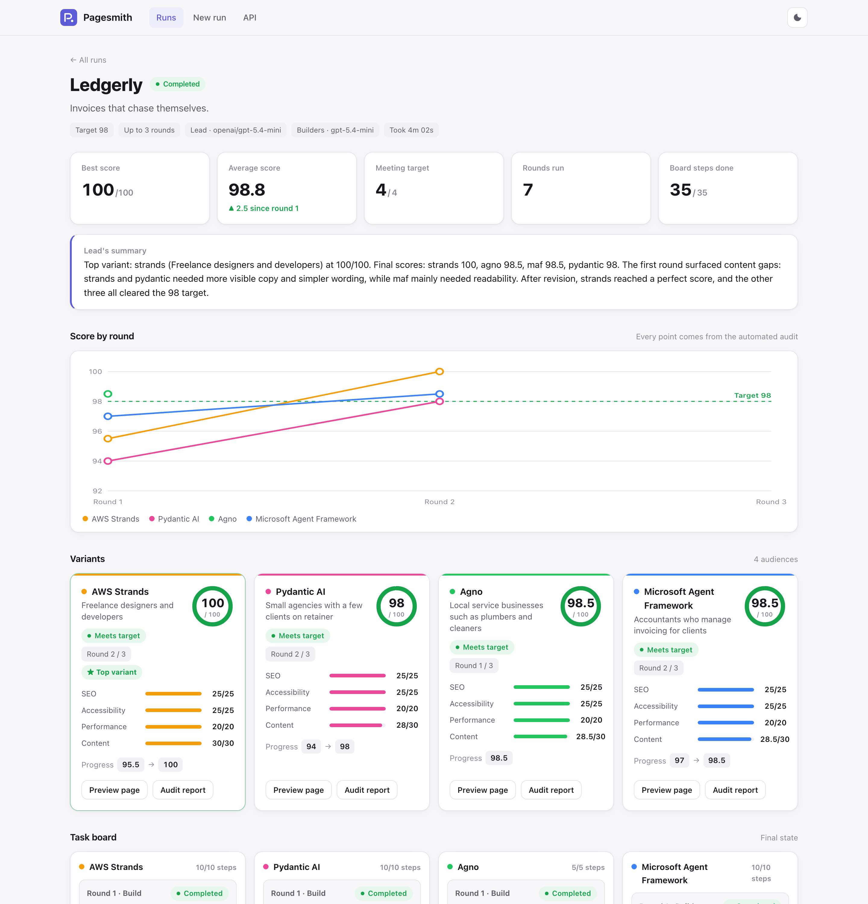
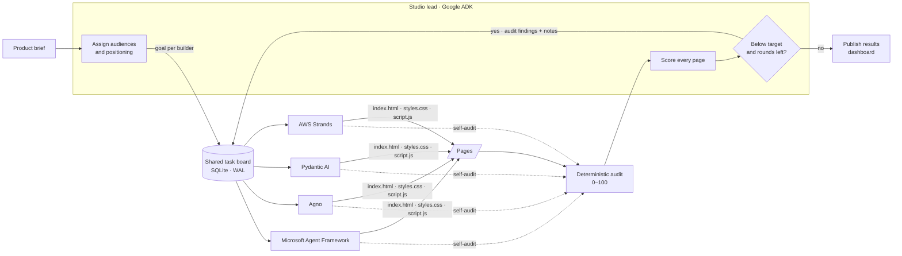
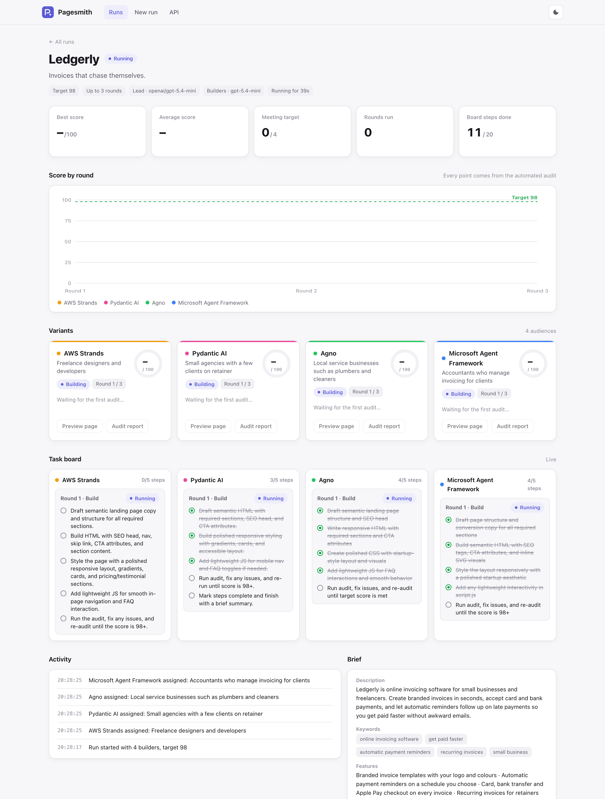
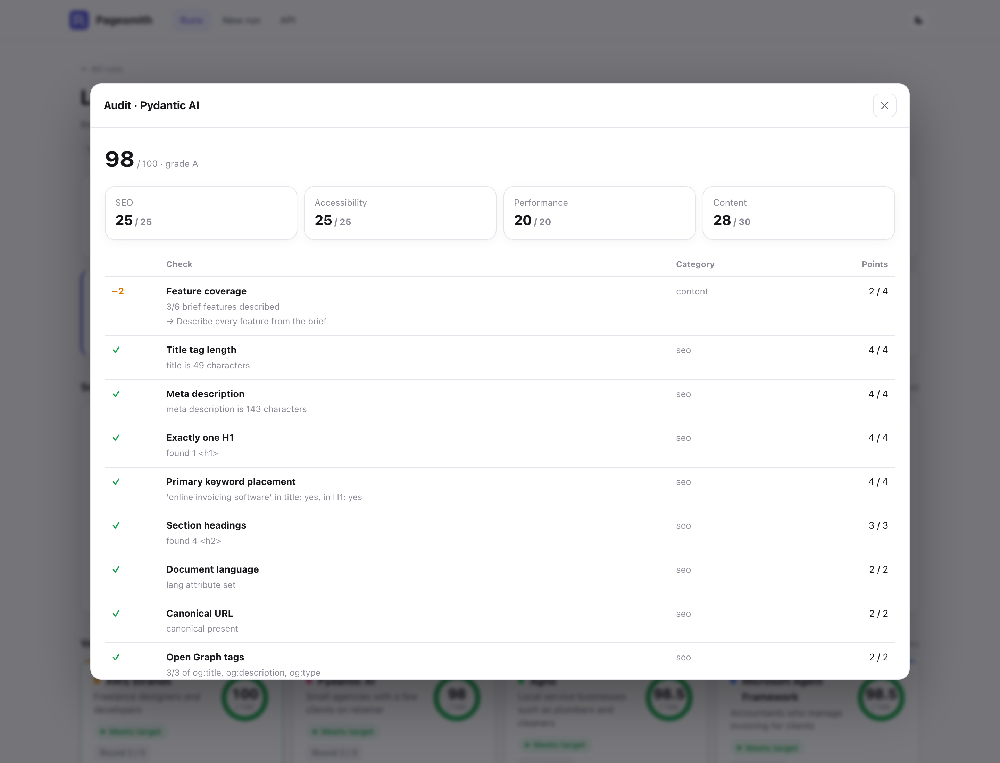
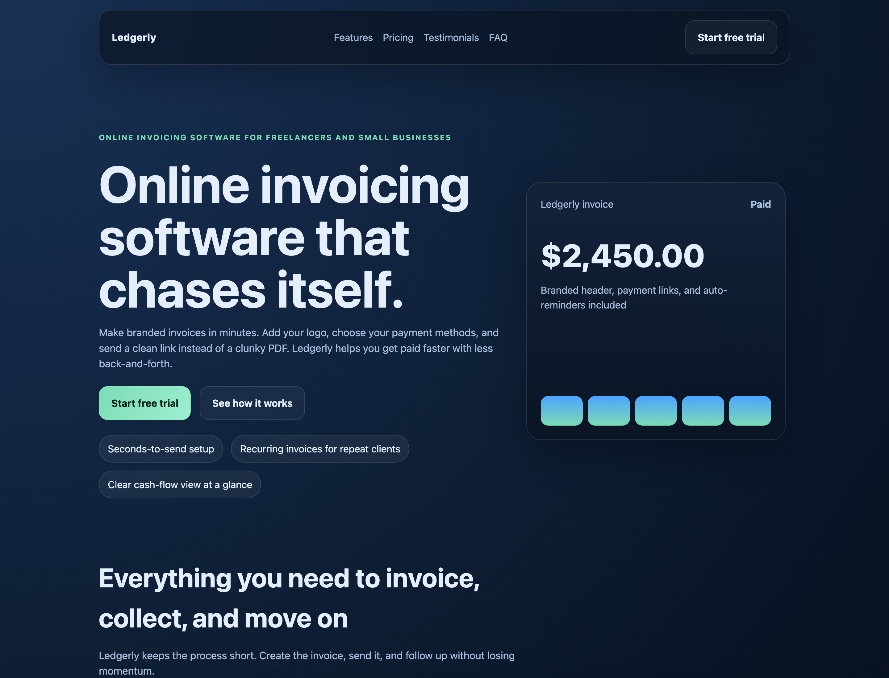
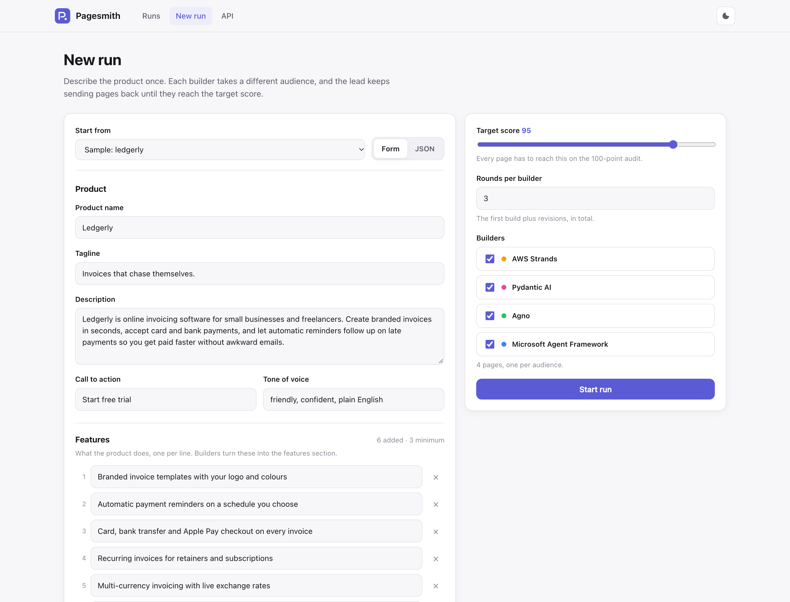
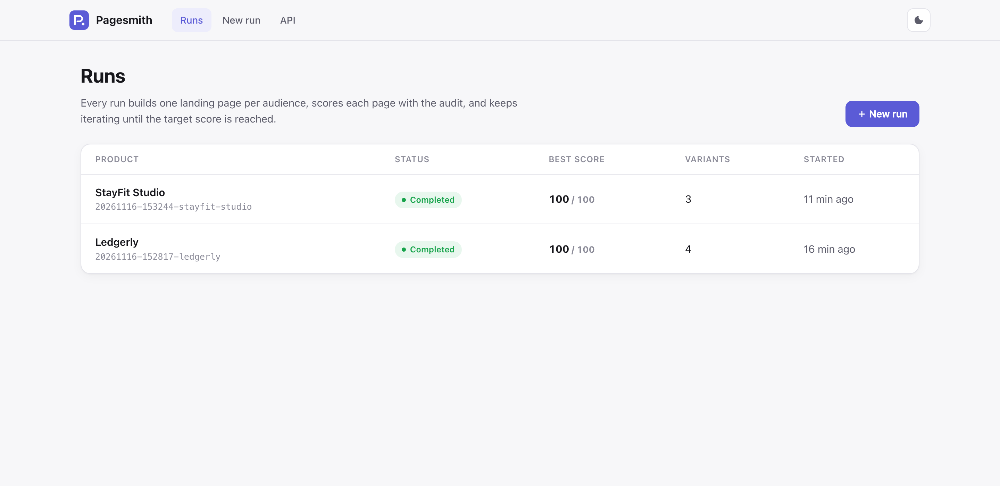
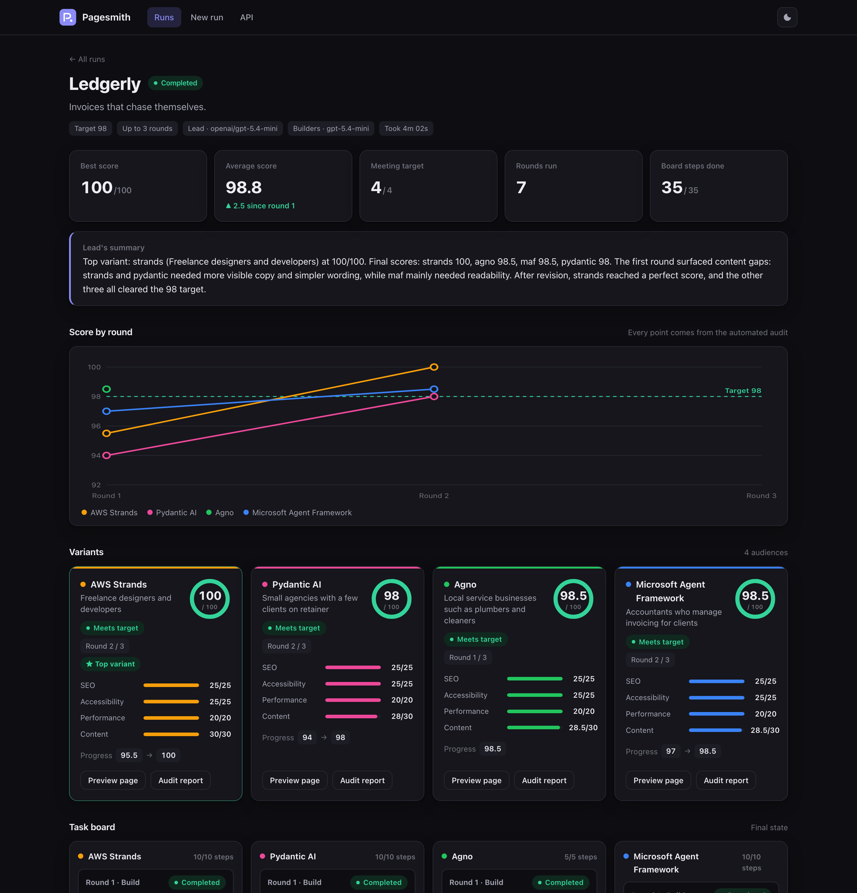

<div align="center">


# Pagesmith

**A multi-agent landing page studio that keeps iterating until the numbers say it's done.**

Give it a product brief. Four builders, each running on a different agent framework, design one landing page per audience **in parallel** on a shared task board. Every page is scored by a deterministic 100-point audit, and a lead agent keeps sending work back until every variant clears the target.




</div>

---

## Contents

- [Why I built this](#why-i-built-this)
- [How it works](#how-it-works)
- [The score](#the-score)
- [Results](#results)
- [Screenshots](#screenshots)
- [Quick start](#quick-start)
- [Usage](#usage)
- [Configuration](#configuration)
- [Deployment](#deployment)
- [Project structure](#project-structure)
- [Extending Pagesmith](#extending-pagesmith)
- [Roadmap](#roadmap)

## Why I built this

Teams that sell to more than one kind of customer need more than one landing page. A freelancer and an accounting firm buy the same invoicing tool for different reasons, and one generic page convinces neither.

Generating pages is the easy part. The hard part is knowing whether a page is any good. "It looks fine" doesn't scale, and asking another model whether a page is good gives you an opinion, not a measurement.

Pagesmith treats it as an optimisation problem:

1. **A measurable outcome.** A deterministic audit scores each page from 0 to 100 on SEO, accessibility, performance and content. The same page always gets the same score, and every lost point comes with a concrete fix.
2. **An inner loop.** Each builder can run the audit on its own page, fix what it reports and audit again before it hands the page in.
3. **An outer loop.** The lead re-scores every page and sends anything below target back with the audit findings and its own priorities, round after round, until the target is met or the round budget runs out.

It's also a hands-on comparison of agent frameworks. The same job, the same tools and the same board run on four different stacks side by side.

## How it works



| Role | Runs on | What it does |
| --- | --- | --- |
| **Studio lead** | Google ADK (any LiteLLM model) | Picks an audience and positioning angle for each builder, waits on the board, scores, decides who goes back and with what notes, and writes the final summary. |
| **Builders** | AWS Strands, Pydantic AI, Agno, Microsoft Agent Framework | Each owns one variant. It plans its steps on the board, writes three files, runs the audit, iterates, ticks steps off and closes its goal. |
| **Task board** | SQLite in WAL mode | The only coordination channel. Goals, steps, owners, rounds and results, shared by every process. |
| **Audit** | Pure Python + BeautifulSoup | The scoring function. It never calls a model. |
| **Dashboard** | FastAPI + vanilla JS | Live board, score-by-round chart, per-variant breakdowns, page previews and full audit reports. |

Every builder runs in its **own process**. Frameworks never share an event loop or global state, they genuinely run in parallel, and a builder that hangs can be stopped without touching the others.

All four builders share one toolkit of plain, typed Python functions: `read_task`, `plan_steps`, `complete_step`, `write_file`, `read_file`, `run_audit` and `finish`. Each toolkit is bound to one goal and one folder, so a builder can't read or write anything outside its own page.

## The score

| Category | Points | Checks |
| --- | ---: | --- |
| **SEO** | 25 | Title length · meta description length · exactly one H1 · primary keyword in title and H1 · section headings · `lang` · canonical URL · Open Graph |
| **Accessibility** | 25 | Image alt text · accessible names for links and buttons · labelled form fields · landmarks (`header`, `nav`, `main`, `footer`) · heading order · skip link |
| **Performance** | 20 | Total weight ≤ 60 KB · zero third-party requests · DOM size · viewport meta and non-blocking scripts |
| **Content** | 30 | Copy length · brief keyword coverage · brief feature coverage · required sections (`hero`, `features`, `pricing`, `testimonials`, `faq`) · at least two calls to action · Flesch reading ease · brand colours used (when the brief sets a palette) |

Grades: **A** ≥ 90 · **B** ≥ 80 · **C** ≥ 70 · **D** ≥ 60. You can run the audit on any folder without the studio:

```bash
uv run pagesmith audit path/to/page --brief briefs/ledgerly.json
```

```text
98/100 (grade A)
  SEO               25 / 25
  Accessibility     25 / 25
  Performance       20 / 20
  Content           28 / 30

Where points were lost:
- [content] Feature coverage: 3/6 brief features described. Fix: Describe every feature from the brief (+2 pts)
```

## Results

A run on the sample [Ledgerly](briefs/ledgerly.json) brief, with a deliberately high target of **98** and up to three rounds:

| Builder | Audience | Round 1 | Final | Rounds |
| --- | --- | ---: | ---: | ---: |
| AWS Strands | Freelance designers and developers | 95.5 | **100** | 2 |
| Microsoft Agent Framework | Accountants who manage client invoicing | 97 | **98.5** | 2 |
| Agno | Local service businesses | 98.5 | **98.5** | 1 |
| Pydantic AI | Small agencies on retainer | 94 | **98** | 2 |

Three of the four first drafts missed the bar, mostly on copy length, readability and feature coverage. The lead sent those three back with the audit findings plus its own notes, and all four variants met the target. The average went from 96.3 to 98.8 in 4 minutes, with no human in the loop.

## Screenshots

| | |
| --- | --- |
| <br>**Live run.** Four builders post their plans and tick steps off in parallel. | <br>**Audit report.** Every check, the points lost and the exact fix. |
| <br>**A generated variant.** Three local files, no external requests. | <br>**New run.** Fill in the brief as a form (or paste JSON), set the target and pick builders. |
| <br>**Run history.** Every run is kept with its pages and scores. | <br>**Dark mode.** Follows the system setting, or toggle it. |

## Quick start

**Prerequisites:** Python 3.12+, [uv](https://docs.astral.sh/uv/) and an API key from OpenAI, Anthropic, Google Gemini or OpenRouter (see [Model providers](#model-providers)).

```bash
git clone https://github.com/Umairr/pagesmith.git
cd pagesmith
cp .env.example .env          # then add one provider key
uv sync
```

Run the studio on the sample brief:

```bash
uv run pagesmith run --brief briefs/ledgerly.json
```

Open the dashboard:

```bash
uv run pagesmith serve
```

Then visit <http://localhost:8000>.

A full run with four builders and a 95 target usually takes 3 to 8 minutes and costs a few cents with `gpt-5.4-mini`. Larger models cost more and are usually slower, so try a short run first.

## Usage

```bash
# Build, score and iterate (all four builders, target 95, up to 3 rounds)
uv run pagesmith run --brief briefs/ledgerly.json

# Raise the bar and allow more rounds
uv run pagesmith run --brief briefs/stayfit.json --target 98 --rounds 4

# Match the colours and style of a page you like
uv run pagesmith run --brief briefs/ledgerly.json --reference ~/Desktop/inspiration.png

# Only some builders
uv run pagesmith run --brief briefs/ledgerly.json --builders agno pydantic
uv run pagesmith run --brief briefs/ledgerly.json --skip maf

# Score any page folder against a brief (add --json for machine-readable output)
uv run pagesmith audit runs/<run-id>/pages/agno --brief briefs/ledgerly.json

# List past runs
uv run pagesmith runs

# Dashboard and REST API (OpenAPI docs at /api/docs)
uv run pagesmith serve --port 8000
```

### Writing a brief

A brief is a small JSON file. Pagesmith builds one variant per audience, up to the number of builders.

```json
{
  "product": "Ledgerly",
  "tagline": "Invoices that chase themselves.",
  "description": "Online invoicing software for small businesses and freelancers...",
  "features": ["Branded invoice templates", "Automatic payment reminders", "..."],
  "pricing": [{ "name": "Growth", "price": "$19/month", "includes": ["Unlimited invoices"] }],
  "keywords": ["online invoicing software", "get paid faster", "recurring invoices"],
  "audiences": ["Freelance designers and developers", "Small agencies", "..."],
  "call_to_action": "Start free trial",
  "tone": "friendly, confident, plain English"
}
```

The first keyword is the primary keyword, which the audit expects in both the title and the H1. See [`briefs/`](briefs) for complete examples.

### Look and feel

By default each builder picks its own design. To pin the look, add a `style` block, give a reference screenshot, or both:

```json
"style": {
  "primary": "#56cfe1",
  "accent": "#f59e0b",
  "background": "#ffffff",
  "surface": "#eef8ec",
  "text": "#222222",
  "font": "rounded geometric sans, like Poppins",
  "notes": "centred white card on a mint band, square inputs, wide flat button"
}
```

Every field is optional. Builders receive the palette as CSS custom properties to use, and the audit's **Brand colours** check (4 of the 30 Content points) confirms each colour actually appears in `styles.css`.

With `--reference` (or by dropping a screenshot on the **New run** form) Pagesmith reads the style off the image. Pillow quantises the pixels to find the real colours, and the lead's model, which needs to support images, names their roles and writes short design notes on layout, spacing and buttons. Colours from the model are snapped to the nearest real pixel colour. Anything you set in the brief wins over what was read, and the screenshot is saved in the run folder and shown on the run page.

### Output

```
runs/<run-id>/
├── run.json          brief, settings, status, score history, activity log, summary
├── board.sqlite      the shared task board
├── reference.png     the reference screenshot, when one was given
├── logs/             one log per builder per round
└── pages/<builder>/  index.html · styles.css · script.js
```

Each page is self-contained, so you can open `index.html` straight from disk or deploy the folder to any static host.

## Configuration

All settings are environment variables, which can also live in `.env`.

| Variable | Default | Description |
| --- | --- | --- |
| `OPENAI_API_KEY` / `ANTHROPIC_API_KEY` / `GEMINI_API_KEY` / `OPENROUTER_API_KEY` | (one required) | Provider keys. `GOOGLE_API_KEY` is accepted for Gemini. |
| `PAGESMITH_MODEL` | first provider with a key | `provider/model` used by the lead and every builder. |
| `PAGESMITH_ORCHESTRATOR_MODEL` | `PAGESMITH_MODEL` | Overrides the lead's model only. |
| `PAGESMITH_BUILDER_MODEL` | `PAGESMITH_MODEL` | Overrides the builders' model only. |
| `PAGESMITH_BASE_URL` / `PAGESMITH_API_KEY` | (empty) | Any OpenAI-compatible endpoint, used with `custom/<model>`. |
| `PAGESMITH_MAX_TOKENS` | `16000` | Reply cap sent to non-OpenAI providers. Lower it if OpenRouter reports too few credits. |
| `PAGESMITH_TARGET_SCORE` | `95` | Score every variant must reach. |
| `PAGESMITH_MAX_ROUNDS` | `3` | Rounds per builder, the first build included. |
| `PAGESMITH_BUILDER_TIMEOUT_S` | `420` | A builder still running after this is stopped and its goal marked failed. |
| `PAGESMITH_ORCHESTRATOR_MAX_CALLS` | `60` | Upper bound on the lead's model calls per run. |
| `PAGESMITH_RUNS_DIR` | `./runs` | Where runs are stored. |
| `PAGESMITH_ACCESS_TOKEN` | (empty) | When set, starting a run from the dashboard requires this token. **Always set it on a public deployment.** |

### Model providers

Models are written as `provider/model`. Put one key in `.env` and Pagesmith picks the provider up on its own, with a sensible default model; set `PAGESMITH_MODEL` (or pass `--model`) to choose.

| Provider | Key | Example | Default model |
| --- | --- | --- | --- |
| OpenAI | `OPENAI_API_KEY` | `openai/gpt-5.4-mini` | `gpt-5.4-mini` |
| Anthropic | `ANTHROPIC_API_KEY` | `anthropic/claude-sonnet-5-5` | `claude-opus-5-5` |
| Google Gemini | `GEMINI_API_KEY` | `gemini/gemini-3.7-flash` | `gemini-3.7-flash` |
| OpenRouter | `OPENROUTER_API_KEY` | `openrouter/anthropic/claude-haiku-5-5` | `openai/gpt-5.4-mini` |
| Anything OpenAI-compatible | `PAGESMITH_BASE_URL` (+ `PAGESMITH_API_KEY`) | `custom/llama3.3` | (none) |

```bash
uv run pagesmith run --brief briefs/ledgerly.json --model anthropic/claude-sonnet-5-5
```

Every framework talks to the provider through its own native client (Strands, Pydantic AI and Agno have first-party Anthropic and Gemini models; Microsoft Agent Framework uses its Anthropic client, and chat completions for the rest). The lead goes through LiteLLM. Mixing is fine too: a cheap model for the builders and a stronger one for the lead, or the other way round.

## Deployment

The dashboard and the studio ship as one container. Starting a run from the dashboard launches the studio as a background process in the same container, and runs are written to a mounted volume.

### Docker

```bash
docker build -t pagesmith .
docker run -p 8000:8000 \
  -e OPENAI_API_KEY=sk-... \
  -e PAGESMITH_ACCESS_TOKEN=choose-a-long-secret \
  -v pagesmith-data:/data \
  pagesmith
```

Swap `OPENAI_API_KEY` for `ANTHROPIC_API_KEY`, `GEMINI_API_KEY` or `OPENROUTER_API_KEY` to run on another provider, and add `-e PAGESMITH_MODEL=...` to pick the model.

The image runs as a non-root user, exposes `/healthz` for health checks and honours the `PORT` variable that most platforms set.

### Render (one click)

The repository includes a [`render.yaml`](render.yaml) blueprint.

1. Push the repository to GitHub.
2. In Render, choose **New → Blueprint** and select the repository.
3. Enter a key for at least one provider when prompted (leave the others blank), and optionally `PAGESMITH_MODEL`. `PAGESMITH_ACCESS_TOKEN` is generated for you; copy it from the service's **Environment** tab.
4. Deploy. The blueprint attaches a 1 GB persistent disk at `/data`, so runs survive redeploys.

> A persistent disk needs a paid instance type (Starter or above). On the free tier, the app works but runs are lost on every restart.

### Railway, Fly.io and other container hosts

Any platform that builds a Dockerfile works:

- Set one provider key (for example `OPENAI_API_KEY` or `ANTHROPIC_API_KEY`) and `PAGESMITH_ACCESS_TOKEN`.
- Mount a volume at `/data` to keep run history.
- Point the health check at `/healthz`.

On Fly.io, for example:

```bash
fly launch --no-deploy
fly volumes create pagesmith_data --size 1
fly secrets set OPENAI_API_KEY=sk-... PAGESMITH_ACCESS_TOKEN=...
fly deploy
```

Add a `[mounts]` section to `fly.toml` with `source = "pagesmith_data"` and `destination = "/data"`.

### Publishing a generated page

Every variant is three static files. To put the winning page live, copy its folder to Netlify, Vercel, GitHub Pages, S3 or any static host:

```bash
npx netlify-cli deploy --dir runs/<run-id>/pages/<builder> --prod
```

## Project structure

```
pagesmith/
├── briefs/                     sample product briefs
├── docs/screenshots/           images used in this README
├── src/pagesmith/
│   ├── audit.py                the 100-point scoring function
│   ├── board.py                shared SQLite task board
│   ├── brief.py                brief schema (Pydantic)
│   ├── cli.py                  `pagesmith` command
│   ├── config.py               environment settings
│   ├── console.py              live terminal board (rich)
│   ├── orchestrator.py         the studio lead (Google ADK) and its tools
│   ├── prompts.py              every prompt in one place
│   ├── models.py               provider/model parsing and keys
│   ├── store.py                run folders and atomic state writes
│   ├── style.py                colours and style from a reference screenshot
│   ├── toolkit.py              tools shared by every builder
│   ├── workers/                one builder per framework
│   │   ├── _entry.py           shared process entry point
│   │   ├── agno_builder.py
│   │   ├── maf_builder.py
│   │   ├── pydantic_builder.py
│   │   └── strands_builder.py
│   └── web/                    FastAPI app and dashboard
├── tests/                      audit, board, model and style tests
├── Dockerfile
├── render.yaml
└── pyproject.toml
```

## Running the tests

```bash
uv run --group dev pytest
```

The audit is fully deterministic, so it's covered by plain unit tests: a reference page that scores exactly 100, missing sections, third-party resources, issue ordering and score stability.

## Extending Pagesmith

**Add a builder on another framework.** Write a module in `src/pagesmith/workers/` with an `async def build(tools, instructions, message, spec)` that runs your framework's agent with the given tools, end it with `main(build)`, and register it in `workers/__init__.py`. The toolkit, board and audit stay the same.

**Change what "good" means.** Every check in `audit.py` is a small function that returns points, a detail and a hint. Adjust the weights or add a check (contrast ratios, a Lighthouse run, conversion data from a real A/B test) and the whole loop optimises for the new definition.

**Add a model provider.** Register it in `src/pagesmith/models.py` (key variable, default model, endpoint) and add a branch to each builder's `make_model`. Anything that speaks OpenAI chat completions already works through `custom/...`.

## Roadmap

- [ ] Lighthouse scoring in a headless browser, alongside the static audit
- [ ] Colour contrast checks from computed styles
- [ ] Export the winning variant straight to Netlify or Vercel from the dashboard
- [ ] Real A/B traffic split, with conversion rate feeding back into the score
- [ ] Mastra (TypeScript) builder

## License

[MIT](LICENSE) © Agha Umair Ahmed
